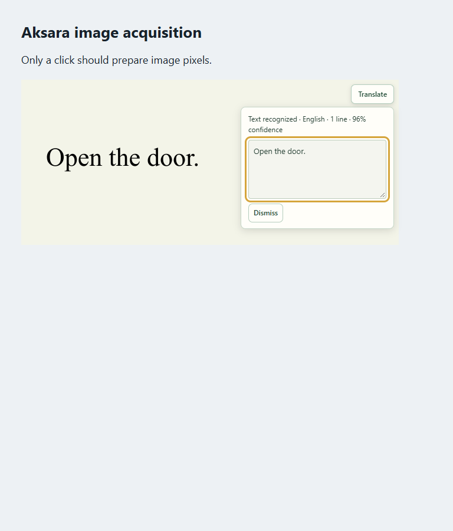
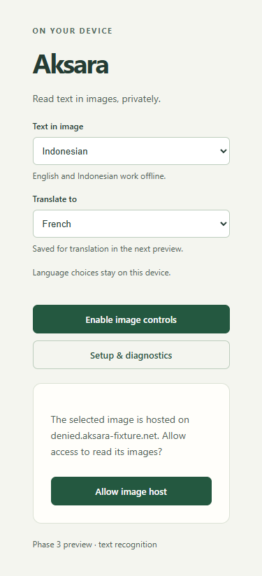

# Phase 3 — OCR and language controls

## Design contract

The product surface is Aksara's extension popup and the existing on-image status card. The job is to choose the language printed in an image, read it locally, and inspect selectable text. The primary action remains the image's Translate control. This phase supplies recognition; translation and aligned translated overlays remain later phases.

The existing UI is the visual reference: quiet green controls, warm neutral surfaces, visible keyboard focus, compact spacing, and no remote fonts. The popup puts language controls before activation. The page card puts recognition status before selectable text and Dismiss. Source English and Indonesian map to the two bundled Tesseract packs; target Indonesian, English and French are saved for the translation phase. Settings are captured at job start.

Target page viewports are 375 × 812, 768 × 900 and 1440 × 900. Popup width is 330 pixels within Chrome's extension surface. Page cards stay within the viewport; long text scrolls inside a labeled, read-only field. Motion respects reduced-motion preferences. Keyboard users can activate, cancel, select recognized text and dismiss without losing focus.

| State | Trigger | Feedback and next action |
| --- | --- | --- |
| Loading | Image acquisition, decoder, OCR setup or recognition | Named stage and recognition percentage when available; Cancel |
| Empty | OCR returns no text | Check source language or choose a sharper image, then retry |
| Error | Image access, decode, OCR failure or deadline | Specific explanation with retry or permission guidance |
| Partial | Low confidence or bounded output was truncated | Keep available text, label the uncertainty or output limit, and offer retry |
| Success | OCR completes on an unchanged image | Language, confidence, line count and selectable text; Dismiss |
| Permission | Separate image host lacks access | Named-host popup grant followed by a fresh click |

## Implementation

Date: 25 October 2026. Version: 0.3.0. The Phase 3 exit gate passes: webpage images produce repeatable English/Indonesian OCR with line boxes and confidence using packaged local assets.

- The service worker reads validated language settings at job start, keeps the Phase 2 ownership/snapshot/access checks, and stages the image Blob in extension-origin IndexedDB.
- The offscreen document verifies and decodes the image, flattens transparency onto white and draws the decoded still at its natural dimensions. No scaling or automatic rotation occurs after that normalization, so OCR coordinates refer to the returned width/height, including decoded EXIF orientation.
- Tesseract runs with bundled JS, WASM and English/Indonesian traineddata, LSTM recognition and automatic page layout. If that layout returns empty text, one sparse-text retry runs within the same deadline. The full Tesseract page graph never crosses runtime JSON; only bounded text, line boxes and confidence are retained.
- The result card shows a read-only, selectable text field, source language, line count and confidence. Empty OCR returns `NO_TEXT_FOUND`; confidence below 0.6 on the page or any returned line adds an uncertainty message without hiding text. Scores are OCR confidence estimates, not measured probabilities of correctness. Truncated output is labeled.
- Language preferences use NLLB codes: English `eng_Latn` maps to OCR `eng`, Indonesian `ind_Latn` to `ind`. Target options are Indonesian, English and French (`fra_Latn`). Target selection is saved and returned as metadata; it does not initiate translation in this preview. Automatic source-language detection is not implemented.
- The content script clears completed text when `currentSrc` changes, including responsive `<picture>` selection. New reads and Dismiss remove the previous text. Output is assigned as text/textarea values rather than HTML. Cancel/Dismiss are keyboard reachable, Dismiss restores focus, and the card stays inside the viewport.
- Re-enabling controls after an unpacked-extension reload disposes the previous UI using an extension-owned DOM marker and a teardown-only event. That event can remove controls, but cannot start OCR or grant image access. It prevents stale duplicate controls and observers when Chrome replaces the isolated context.

## Lifecycle, bounds and privacy

Acquisition retains the Phase 2 limits: 8 MiB input, 16 million pixels, 8192 pixels per dimension, sequential 192 KiB binary-equivalent chunks and a 30-second acquisition deadline. OCR has a separate 90-second deadline. The content script adds a 130-second overall deadline and checks the worker instance every five seconds only while a request is pending. Background heartbeats apply only to bounded active OCR work. There are no idle keepalives.

One image or diagnostic job runs at a time. A successful read terminates its OCR worker, closes its bitmap/canvas backing store, and removes its staged Blob. Cancellation or a page-image OCR failure closes the offscreen document to reclaim even a worker that has not finished initializing. This can also release an idle offscreen translation worker; cached model files remain on disk. A job's workload lock remains held until the cancelled host settles.

Session recovery stores only an opaque `activeImageJob.id`, and startup closes an orphaned host before accepting another image. The page reports interruption and permits retry. Recognized text and image pixels are not persisted as application data; language choices remain local. This phase sends no OCR data to diagnostics or remote services. Text shown inside the webpage's DOM is visible to page scripts; the extension does not provide isolation from the website itself.

Output limits are 20,000 characters of page text, 500 line records and 2,000 characters per line. Line boxes are clipped to natural-image bounds; non-finite, inverted or empty boxes are dropped. Confidence is clamped to [0, 1]. The image-access rules, redirect behavior and lexical-DNS limitations in [Phase 2](PHASE_2.md) still apply. HTTP(S) image acquisition still needs the image server; offline OCR is verified for readable inline pixels.

## Message contracts

The named `aksara-images` port and schema version 1 remain in place. Content start requests still carry only `requestId` and `imageId`; the service worker reads settings and the authoritative image snapshot itself. Phase 2 upload/cancel/error messages remain valid.

`IMAGE_PROGRESS` adds `ocr_prepare` and `ocr` stages, with a nullable `fraction`. Port replies include an opaque `workerInstanceId`. `PING` returns the corresponding `instanceId` so a pending request can detect a restarted background context. No text is included in these lifecycle checks.

An `IMAGE_READY` retains the Phase 2 image summary and adds `image.ocr`:

```json
{
  "text": "Open the door.",
  "confidence": 0.96,
  "lowConfidence": false,
  "truncated": false,
  "sourceLanguage": "eng_Latn",
  "targetLanguage": "ind_Latn",
  "imageWidth": 640,
  "imageHeight": 280,
  "elapsedMs": 600,
  "lines": [
    {
      "segmentId": "s1",
      "text": "Open the door.",
      "confidence": 0.96,
      "lowConfidence": false,
      "box": { "x": 44, "y": 115, "width": 255, "height": 40 }
    }
  ]
}
```

Internal processing uses `{ "schemaVersion": 1, "target": "offscreen", "type": "READ_IMAGE", "jobId": "opaque-id", "languages": { "sourceLanguage": "eng_Latn", "targetLanguage": "ind_Latn" } }`. The offscreen document accepts extension contexts only and reads bytes from IndexedDB. New error codes include `NO_TEXT_FOUND`, `OCR_LANGUAGE_MISSING`, `OCR_FAILED` and `OCR_TIMEOUT`.

## Validation

The production build and 28 automated package/policy/result checks pass. All 20 real Chromium image/OCR cases pass, including language persistence, English and Indonesian text with natural-coordinate boxes, offline inline OCR, low-confidence noise, blank images, cancellation during initialization, forced background-target termination and recovery, unpacked-extension reload and reinjection, source replacement and 375/768/1440 pixel layouts. Every case finishes with zero staged image records. The browser suite rejects all non-fixture HTTP(S) requests. It uses actual Tesseract, without inference mocks or a translation model download.

The popup and result card have zero automated axe violations in the tested states and sizes. Keyboard activation, text focus and cancel/dismiss behavior are exercised. This is not a full screen-reader or WCAG conformance audit. The actual Chrome optional-permission prompt and activation from Chrome's action popup remain manual checks; fixture host grants are added only to a copied test manifest.

The existing OCR/WebGPU diagnostic smoke test also passes. Translation code and model assets were not changed, and the full NLLB model suite was not rerun in this phase. Minimum Chrome 124 and other device/GPU combinations remain unverified beyond the Chromium 156 Windows test machine.

See [browser evidence](evidence/phase-3/images-report.json), [runtime evidence](evidence/phase-3/runtime-report.json) and [UI QA](evidence/phase-3/QA.md). New screenshots establish review candidates; pixel regression against an approved committed baseline is **inconclusive** because no matching baseline exists.





## Remaining phases

Phase 4 connects recognized text to local translation with first-use model consent and production model lifecycle management. Phase 5 aligns translated overlays. Translation of clicked images, original/translated toggles, general OCR language downloads, automatic language detection, and CSS backgrounds/iframes remain outside this preview. The NLLB research/noncommercial licensing constraint from Phase 1 remains in force.

Implementation uses the packaged Tesseract 7 API for structured block output and worker termination; see the [upstream API reference](https://github.com/naptha/tesseract.js/blob/master/docs/api.md).
