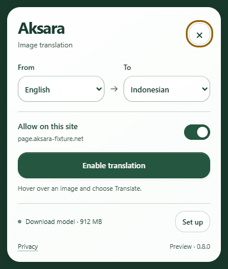

# Floating menu — 0.8.0 — QA

The toolbar now opens Aksara's menu inside the active webpage. The rounded card is preserved and the page is visible around its corners, with no native popup canvas behind it. This implements the user's selected in-page-panel option. The Local badge remains removed.

## Verification

Windows, Chromium 156.0.8078.4, isolated profiles and local fixture pages. The normal menu is invoked through the real toolbar action. It is not a mockup or a screenshot with a painted background. The model state in the first-use capture comes from the actual empty-cache backend. Explicit readiness/loading variants are separately marked fixtures.

| Check | Result | Evidence |
|---|---|---|
| TypeScript + production build | Pass, 0.8.0 | Classic content/menu entries, packaged assets, no default native popup |
| Unit/distribution | 100/100 | `npm test`: local assets, entry parsing, unchanged permissions, no automatic content-script registration or web-accessible resources, cache/geometry/translation logic |
| Floating menu | 10/10 | [page-menu-report.json](page-menu-report.json) |
| Image toolbar/rendering | 13/13 | [glass-report.json](glass-report.json); explicitly labeled UI replays |
| Actual acquisition/OCR | 30/30 | [images-report.json](images-report.json) |
| Actual OCR → NLLB overlays | 20/20 | [overlay-report.json](overlay-report.json); cached pinned weights, actual comic/controlled text |
| Privacy/cache hardening | 7/7 | [hardening-report.json](hardening-report.json); small local fault fixtures |
| Retained native/legacy UI | 9/9 | [popup-report.json](popup-report.json); a native popup is explicitly enabled only in this isolated regression profile, not the production manifest |

Total: **100 unit tests and 89 browser cases**. Saved reports contain no console/page errors or external requests. No model weights were downloaded for these runs. The cached model profile was preserved. Browser suites sharing port 80 ran sequentially; cache-only hardening uses its own offline profile.

## Shape, layout and interaction

The actual toolbar action creates zero native popup views. The card is an automatic Popover in a Shadow DOM, with a transparent backdrop and 22 px rounded surface. At a pixel just outside its curve, the captured RGB is `[23,55,43]`, showing the dark webpage with the soft shadow rather than a white rectangular popup canvas. Hit testing at that corner reaches the webpage. Opening the menu creates no image-control root, image job or offscreen inference host.

Inspected the [full page](menu-rounded-page.png), [375×812](menu-375.png), [768×900](menu-768.png) and [1440×900](menu-1440.png) renders. Native selects, primary action and close button remain inside the viewport. [150% visual-viewport zoom](menu-zoom.png), [forced colors](menu-forced-colors.png) and [opaque reduced-transparency fallback](menu-opaque.png) pass. The panel can scroll on short windows and stacks its language fields below 300 px.

Close, Escape, outside click and another toolbar click dismiss the menu. The outside page action still receives its click. Keyboard language changes persist; site disable clears controls; allowing a site still requires explicit activation. Enabling closes the menu to expose the image; an empty page instead receives a visible no-images message. Reopening recognizes controls without reinjecting or clearing completed translations. Page navigation and same-document URL changes remove the menu.

Synthetic page clicks/changes cannot save preferences, activate controls, open Settings/Privacy or use the Close button. The host can still observe or manipulate injected DOM; Shadow DOM is styling isolation rather than an isolation guarantee. The updated packaged privacy notice explains visible menu state and language selections. Privileged page-origin model/diagnostic requests remain rejected, and subframes cannot use the document-bound activation broker.

Settings/Privacy use fixed extension-owned destinations. A pending image host is scoped to the requesting tab/document before it appears in the page menu. Review image access opens a real [Settings section](menu-settings-access.png) with the named host; the final `chrome.permissions.request` remains directly in a trusted click there. Chrome's native grant dialog is not automatically granted or claimed tested.

The [strict CSP fixture](menu-strict-csp.png) requires Trusted Types and blocks ordinary page scripts. The packaged isolated-world menu and image-control activation still work. The fixture's own click-counter listener is installed by the test harness; no inline-handler violation is hidden or filtered from the final report.

## Content states and limits

The [ready](menu-fixture-ready.png), [partial](menu-fixture-partial.png), [running](menu-fixture-running.png), [unavailable](menu-fixture-error.png) and [loading](menu-fixture-loading.png) captures deliberately substitute read-only UI metadata. They do not claim an actual download, GPU error or inference result. First-use missing-model state, activation, Settings routing and actual OCR/NLLB regression are separate real paths.

Axe reports zero A/AA violations in the extension-owned menu at three widths, including forced colors. The audit is scoped to `#aksara-menu-root`: at narrow widths, the opaque nonmodal card covers some host-page text, which is not a valid contrast target for this extension's UI. Native labels, keyboard saving, focus/dismissal and viewport fit were also exercised. This does not certify accessibility; manual screen-reader/native grant-dialog checks and independent devices remain outstanding.

The menu is about 18.32 kB / 6.31 kB gzip, with no new package or manifest permission. It reads only preferences and compact readiness/connection metadata on opening. There is no new per-text filter, inference instance or continuous animation. Running-model readiness polls every four seconds only while its menu remains open. These cost bounds do not establish power use or field Core Web Vitals on all devices.

Functional local preview: **PASS**. Pixel regression: **INCONCLUSIVE** without an approved matching baseline. Existing public-release gates in [Phase 6](../../PHASE_6.md) remain in force.

Reload Aksara at `chrome://extensions`, refresh the webpage, then click the toolbar icon. Confirm **Preview · 0.8.0**. Normal websites get the floating card; restricted browser pages open Settings instead.
