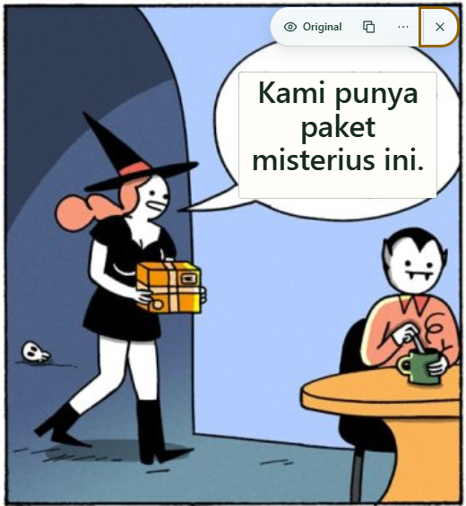

# Overlay UI QA — 0.7.0 — 2026-11-07

The normal translated view is now a roughly 212×44 px toolbar containing Original, Copy, More and Close. The permanent result card, Text details button, visible confidence score and generic accuracy warning are removed. More contains Translate again and High contrast. Read/Partial appears when a full-text fallback is needed. Loading, empty/error, missing-model setup and actual skipped-text feedback retain recovery paths.

## Verification

Local Windows environment, Chromium 156.0.8078.4. These browser runs use isolated profiles and local fixture pages. Model inference uses the existing pinned cached NLLB q8 weights; no inference API is used. The regular Chrome profile is untouched.

| Check | Result | Evidence |
|---|---|---|
| TypeScript + production build | Pass, version 0.7.0 | Packaged content script 41.86 kB, approximately 14.36 kB gzip; no new dependency; inference workers unchanged |
| Unit/distribution checks | 100/100 | `npm test`: assets, packaging, permission scope, message/cache/geometry/translation logic |
| UI rendering journeys | 13/13 | [glass-report.json](glass-report.json); explicitly replayed rendering, not inference |
| Real image/OCR acquisition | 30/30 | [images-report.json](images-report.json); language, host access, CSP, invalidation, cancellation and restart |
| Real OCR → NLLB overlays | 20/20 | [overlay-report.json](overlay-report.json); context/bubble separation, source coordinates, retry/copy, fit/crop/zoom/scroll, site controls and invalidation |
| Real translation | 12/12 | [translation-report.json](translation-report.json); first-use checks, cached SHA verification, three translation directions, offline, cancel and worker recovery |
| Privacy/cache hardening | 7/7 | [hardening-report.json](hardening-report.json); tiny real CacheStorage fault fixtures and unavailable WebGPU |
| Evidence completeness | Pass | `check-evidence.js evidence.json`; artifact validation supplements rendered inspection |

The total is 100 unit tests and 82 browser cases. Browser reports contain no console/page errors. The UI rendering and actual OCR/overlay suites report no external requests; the cached translation suite reports no external requests. Hardening's repair test uses local fixture data. Saved reports include version/timing details and distinguish synthetic rendering/fault cases from actual inference.

## Rendered and interaction observations

Inspected [375×812 light](glass-375.png), [768×900 dark](glass-768.png) and [1440×900 busy](glass-1440.png) captures. Controls stay inside the viewport and preserve readable colors over host pages. The neutral glass remains confined to the active toolbar; image text has its original opaque backing. Normal success has no open panel. Opening More keeps the toolbar anchor stable. The secondary menu is two rows; the fallback reader is an explicit temporary surface.

The UI tests cover named native buttons, Enter, arrow keys, Escape, outside pointer/focus dismissal, and focus restoration. Copy pastes only the known fixture translation; blocked clipboard access exposes selectable text. [Partial output](glass-partial.png) has a contextual action and a specific skipped-text note in its reader. [Loading](glass-loading.png), [empty](glass-empty.png), [setup](glass-setup.png) and [permission feedback](glass-permission.png) have short recovery paths. Open setup reaches the actual fixed options page without starting a download. That permission screenshot is a UI replay; the real image suite checks denied/granted access, rather than automating Chrome's native grant dialog.

Axe found zero WCAG A/AA violations at the three widths, in the partial reader, and with the selected Original button in high contrast. Contrast mode, forced colors and reduced transparency remove blur. Reduced motion stops the spinner. A 150% visual viewport retains reachable menu contents. Automated checks cover part of accessibility; they do not replace screen-reader use.

## Cost and measurement limits

Only one hovered/focused/used image toolbar has blur, verified with two completed image results. The normal surface is about 212×44 px with a 10 px filter; menus/readers do not blur. There are no new packages, remote visual assets, shaders, image-sized filters or decorative animation loops. Equal control state skips DOM rendering; geometry uses the existing visible-result tracker and bounded text fitting.

The UI-only scroll fixture recorded LCP 40 ms, CLS 0, a maximum qualifying Event Timing of 16 ms, no observed long tasks, and a 5.9 ms 95th-percentile animation-frame interval. These are local headless fixture observations. Maximum Event Timing is a proxy, not field INP; the frame sample is not a GPU power measurement or a cross-device frame-rate guarantee. OCR/model loading and inference costs were not optimized by this UI change.

## Verdict and remaining checks

Functional local preview: **PASS**. Visual regression: **INCONCLUSIVE**, because a matching screenshot baseline has not been approved. The rendered captures were inspected directly; no pixel-regression pass is claimed.

Manual screen-reader use, stable Chrome's native grant dialogs, other GPUs/devices and low-memory behavior remain outstanding. The existing public-release decision in [Phase 6](../../PHASE_6.md) remains DO NOT SHIP publicly/commercially pending its listed gates. This task makes no publication or deployment.

To try the local build, reload Aksara at `chrome://extensions`, refresh the webpage, enable image controls from the popup, and translate an image. Cached model data can be reused. The compiled unpacked extension is in the repository's `dist` directory.
