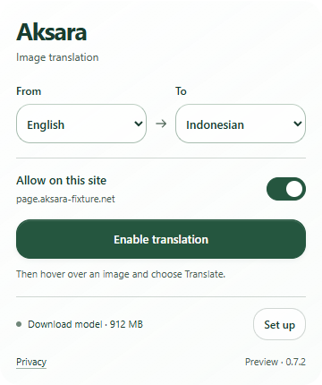

# Popup surface cleanup — 0.7.2

Removed the Local badge, outer 8 px padding, document/body backgrounds, outer card border and exterior shadow. The rounded popup surface now meets the document bounds. Internal content padding and control sizing are retained. This removes Aksara's inset rectangular plate; Chrome controls the native window frame and compositor, so webpage-through transparency is not claimed.

Production build and 100 unit/distribution tests pass. All nine existing popup browser cases pass in Chromium 156.0.8078.4 on Windows. The normal actual action view measures 360×430 px, with matching scroll dimensions and no overflow. [The browser report](popup-report.json) records zero console/page errors and zero external requests. Model/loading variants are explicitly labeled rendering fixtures; no inference or download is performed by these popup tests.

Inspected the actual action capture and extension document at [375×812](popup-375.png), [768×900](popup-768.png) and [1440×900](popup-1440.png). The badge and outer plate are absent; source/target choices and the primary action remain visible. Existing checks cover keyboard saving/focus restoration, site toggling, activation/reopening, recovery states, long hosts, native Setup, enlarged text, opaque/forced-color fallbacks and axe. Automated checks do not certify accessibility. Manual screen-reader/native permission-dialog coverage and an approved pixel baseline remain outstanding; pixel regression is INCONCLUSIVE.

Reload the extension at `chrome://extensions`. The footer should show **Preview · 0.7.2**.
