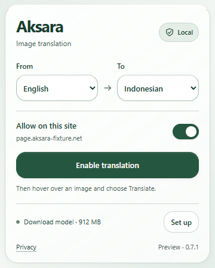

# Popup and rounded text surfaces — 0.7.1

The user's screenshots showed square translation backings and a narrow, heavily scrolling popup. The normal Chrome action view reproduced at 146 px wide with an 873 px document constrained to a 510 px view. The fixed popup measures **360×448 px**, with no overflow in its normal first-use state. Its document has an explicit intrinsic width instead of depending on its initial viewport.

Translated text now uses the shared **16 px** corner token, pale opaque background, green ink, gentle outline and 8 px horizontal padding. Its text fitting and clipping still run through the existing image mapping. The popup uses the same color/radius tokens, a compact wordmark/Local badge, From/To choices, site switch, primary action and short model/settings row. Routine status messages stay available to assistive technology without adding visible rows. Errors and access requests remain visible.

## Validation

Windows, Chromium 156.0.8078.4. All browser checks use isolated test profiles, local fixture pages and packaged extension code. The native action popup is opened with Chrome's real action API and inspected through CDP; it is not replaced by a browser tab for its size/activation checks. The model-state/loading variants are explicitly labeled rendering fixtures in extension tabs. Actual OCR/NLLB runs are covered separately.

| Check | Result | Evidence |
|---|---|---|
| TypeScript + production package | Pass, 0.7.1 | `npm run build`; content script about 42.02 kB / 14.37 kB gzip, popup CSS about 6.13 kB / 1.87 kB gzip |
| Unit/distribution | 100/100 | `npm test`: assets, local execution, permission boundaries, cache, geometry and translation planning |
| Native popup and UI states | 9/9 | [popup-report.json](popup-report.json) |
| Glass toolbar and rounded translation rendering | 13/13 | [glass-report.json](glass-report.json) |
| Actual OCR → NLLB image overlays | 20/20 | [overlay-report.json](overlay-report.json), [actual comic result](context-comic-translated.png), [two bubbles](context-two-bubbles.png) |
| Privacy/cache recovery | 7/7 | [hardening-report.json](hardening-report.json) |
| Local design evidence | Complete | [evidence.json](evidence.json), checked by the installed design skill's evidence checker |

Total: **100 unit tests and 49 browser cases**. Saved browser reports have no page/console errors or external requests. The OCR/overlay suite uses the previously cached pinned model rather than downloading weights. Cache fault fixtures in the hardening suite use small local test data.

## Native window and interaction observations

The first-use native popup has a 360 px viewport, 360 px scroll width and 448 px document/view height. The model's missing status is read from the actual backend. The primary action is visible without scrolling. Keyboard End/Tab changes and saves the target language; Space operates the site switch. Saving restores focus to the switch after its temporary disabled state. Enabling injects the real content script and shows its image controls. Reopening recognizes an enabled page through `controlsEnabled` in `AKSARA_PING`; disabling and then allowing a site still requires explicit reactivation.

The native save-error capture uses a deliberate storage-write fault. The native host-access capture uses a seeded pending-access record and the real popup's permission check; its grant button is keyboard reachable. It does not automate or fabricate Chrome's native permission grant dialog. This longer recovery state can need vertical scrolling in a height-constrained popup (observed 375×510 px view with a 568 px document); it has no horizontal overflow. The normal popup remains compact. Settings reaches the actual Setup page and does not start a download; actual cached model bytes stay zero in that first-use profile.

The native views are not automatically exposed as Playwright Pages, so `scripts/native-popup.mjs` supplies a test-only CDP adapter with trusted mouse/keyboard input and screenshot capture. Model ready/partial/running/error and held-loading metadata use background extension tabs at 360 px width; their captures are named `popup-fixture-*`. Those fixture states do not imply an actual download, GPU failure, or inference run.

## Rendered review and accessibility

Inspected the native [first-use](popup-native-empty.png), [enabled](popup-native-enabled.png), [save error](popup-native-save-error.png), [access request](popup-native-permission.png) and [unsupported page](popup-native-unsupported.png) captures. Inspected the labeled [ready](popup-fixture-ready.png), [partial](popup-fixture-partial.png), [running](popup-fixture-running.png), [error](popup-fixture-error.png) and [loading](popup-fixture-loading.png) variants. Long hostnames remain one line with a full-origin title.

The extension document was also rendered and inspected at [375×812](popup-375.png), [768×900](popup-768.png) and [1440×900](popup-1440.png). Its intrinsic width stays fixed; it does not stretch across a full tab. [125% text sizing](popup-text-125.png) retains fitting labels and controls. This is an explicit text-size fixture, not a native browser-zoom claim. [Forced colors](popup-forced-colors.png) and [reduced transparency](popup-opaque.png) provide opaque/system-color surfaces. Axe reports zero A/AA violations in the native first-use view and at the three document widths, including the forced-color check. Native labels, focus, keyboard saving, activation and recovery were exercised; manual screen-reader coverage remains open.

The rounded translation preview is a UI replay of a saved real result. The actual OCR/NLLB suite separately passed context/bubble separation, geometry, cropping, scroll/resize, copy, retry, high contrast, site disable and invalidation. Rendering checks verify the text backing is opaque, has 16 px corners, fits its region and has no backdrop blur. No new package or per-text filter is introduced. The popup's glass appearance uses static tint/highlights inside its separate document; CSS cannot blur the webpage behind the Chrome window. These design constraints bound the effect's cost without claiming a cross-device power or frame-rate result.

Functional local preview: **PASS**. Pixel regression: **INCONCLUSIVE** until a matching baseline is approved. Native permission-dialog interaction, manual screen-reader use and a broader device matrix remain untested. Existing public-release gates in [Phase 6](../../PHASE_6.md) still apply.

To try this build: reload Aksara at `chrome://extensions`, refresh the webpage, open the popup and choose Enable translation. Confirm **Preview · 0.7.1** in its footer. The original model cache can be reused.
